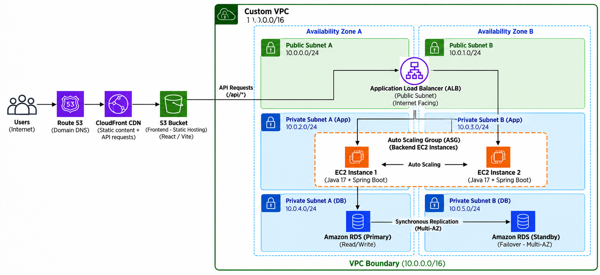

# AWS 3-Tier Student Management Application

## Project Overview
Designed and implemented a scalable and highly available
Student Management Application using AWS services.

## Architecture

## AWS Services Used
- Amazon VPC
- Amazon EC2
- Amazon S3
- Amazon CloudFront
- Amazon Route 53
- Application Load Balancer
- Auto Scaling Group
- Amazon RDS MySQL

## Technologies
- Java 17
- Spring Boot
- React
- MySQL
- Linux
- AWS

## Key Features
- Custom VPC with Public and Private Subnets
- Multi-AZ Architecture
- Load Balancing
- EC2 Auto Scaling
- RDS Database
- CloudFront Content Delivery
